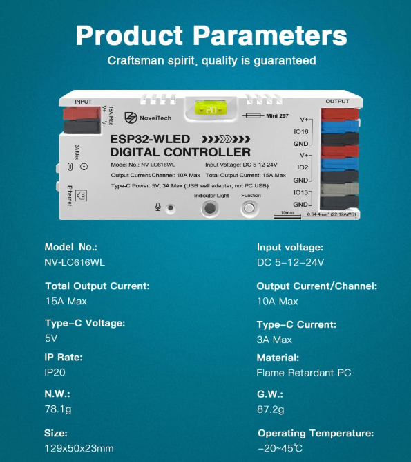

# Pretty Nights — WLED Controller Hardware Specification (`NaveiTech NV-LC616WL`)

This document specifies the physical, electrical, pinout, and network configuration details for the **NaveiTech NV-LC616WL ESP32-WLED Digital Controller** used in the **Pretty Nights** bicycle lighting system.



---

## 1. Hardware Overview & Ratings

| Parameter | Specification | Bicycle Integration Notes |
| :--- | :--- | :--- |
| **Manufacturer / Brand** | NaveiTech | Pre-flashed ESP32 WLED Digital Controller |
| **Model Number** | `NV-LC616WL` | Dual-channel high-current WLED controller with RJ45 Ethernet & Mic |
| **Microcontroller** | ESP32 (Dual-Core 240 MHz) | Supports Wi-Fi (`802.11 b/g/n`), mDNS, and wired RJ45 Ethernet PHY |
| **Primary DC Input (`V+` / `V-`)** | `DC 5V – 12V – 24V` | Quick-lever terminal block (Left side, Red `V+` / Black `V-`). Must match LED strip voltage (`5V`, `12V`, or `24V`—no internal buck converter for strip `V+`). |
| **USB Type-C Input** | `5V DC, 3A Max` | **Power-Only Port** (`"USB wall adapter, not PC USB"`). No USB-serial data lines are connected to the ESP32. Ideal for powering 5V strips from a 5V/3A USB power bank when brightness is capped accordingly. |
| **Max Output Current (Per Channel)** | `10A Max` | High-current WAGO-style lever terminals (`0.34–4 mm²` / `22–12 AWG`) |
| **Max Total Output Current** | `15A Max` | Protected by top-mounted **20A Mini Blade Fuse (`Mini 297`, Yellow)** |
| **Network Interfaces** | **RJ45 Ethernet** (10/100 Mbps) + **2.4 GHz Wi-Fi** | Supports Pretty Nights Dual-Mode Transport (`TRANSPORT_ETHERNET` & `TRANSPORT_WIFI`) |
| **Onboard Audio Sensor** | Built-in MEMS/Electret Microphone | Bottom edge next to status indicator LED; also supports UDP Port `11988` Audio Sync V2 from the Pretty Nights Android app |
| **Enclosure Material** | Flame Retardant PC | White polycarbonate housing with quick-release lever terminals |
| **Ingress Protection (IP Rating)** | **`IP20`** (Non-waterproof) | Has open top cooling vents and exposed fuse; **must be mounted inside a weatherproof frame bag or sealed battery box** on the bicycle |
| **Dimensions (`L × W × H`)** | `129 mm × 50 mm × 23 mm` | Compact rectangular profile for top-tube, triangle, or rack bags |
| **Weight** | `78.1 g` (Net) / `87.2 g` (Gross) | Lightweight for bicycle mounting |
| **Operating Temperature** | `-20°C to +45°C` | Suitable for year-round night riding |

---

## 2. Terminal Pinout & Physical Port Map

```
               ┌──────────────────[ 20A Mini 297 Fuse ]──────────────────┐
  INPUT (Left) │                                                         │ OUTPUT (Right)
 ┌───────────┐ │  NaveiTech                             V+   (Red)   ──► │ [═════] Ch 1 Power
 │ [═══] V+  │ │  ESP32-WLED DIGITAL CONTROLLER         IO16 (Blue)  ──► │ [═════] Ch 1 Data (GPIO 16)
 │ [═══] V-  │ │  Model: NV-LC616WL                     GND  (Black) ──► │ [═════] Ch 1 Ground
 └───────────┘ │  Input: DC 5-12-24V (15A Max)          V+   (Red)   ──► │ [═════] Ch 2 Power
               │  Type-C: 5V, 3A Max (Power Only)       IO2  (Blue)  ──► │ [═════] Ch 2 Data (GPIO 2)
  [USB-C 5V]   │                                        GND  (Black) ──► │ [═════] Ch 2 Ground
  (Power Only) │                                        IO13 (Gray)  ──► │ [═════] Aux I/O (GPIO 13)
               │                                        GND  (Black) ──► │ [═════] Aux Ground
  [RJ45 ETH]   │         [🎤 Mic]   (● Indicator)   (○ Function Btn)     │
 └─────────────┴─────────────────────────────────────────────────────────┴─────────┘
```

### Right-Side Output Lever Terminals (`0.34–4 mm²` / `22–12 AWG`)

| Terminal Group | Label | Lever Color | ESP32 GPIO | Function in Pretty Nights |
| :--- | :--- | :--- | :--- | :--- |
| **LED Channel 1** | `V+` | Red | — | Positive supply rail to LED Strip #1 (fused via 20A Mini 297) |
| **LED Channel 1** | `IO16` | Blue | **`GPIO 16`** | Addressable Data Output #1 (`DI` / `BI` on WS2812B / SK6812 / WS2815) |
| **LED Channel 1** | `GND` | Black | — | Common Ground for LED Strip #1 |
| **LED Channel 2** | `V+` | Red | — | Positive supply rail to LED Strip #2 (fused via 20A Mini 297) |
| **LED Channel 2** | `IO2` | Blue | **`GPIO 2`** | Addressable Data Output #2 (`DI` / `BI` on Secondary / Tail / Fork Strip) |
| **LED Channel 2** | `GND` | Black | — | Common Ground for LED Strip #2 |
| **Auxiliary I/O** | `IO13` | Gray | **`GPIO 13`** | External pushbutton input, relay trigger, or 3rd data-only LED output |
| **Auxiliary I/O** | `GND` | Black | — | Signal Ground reference for `IO13` |

### Onboard Controls & Indicators (Bottom Edge)
- **`Function` Button**:
  - **Short Press**: Toggle WLED power On/Off or cycle presets (configurable in WLED *Time & Macros*).
  - **Long Press (`> 10 seconds`)**: Reset Wi-Fi settings / re-enable `WLED-AP` (`4.3.2.1`).
- **`Indicator Light`**: Status LED showing power and controller operational state.
- **`Microphone` (`🎤`)**: Built-in acoustic sensor for standalone WLED sound-reactive effects when not receiving UDP Audio Sync V2 from the phone.

---

## 3. Dual-Mode Bicycle Connectivity with Pretty Nights

Because the `NV-LC616WL` Type-C port is **power-only** while the **RJ45 Ethernet port** provides a dedicated hardware network interface, Pretty Nights (`WledNetworkTransport.kt`) supports three bicycle wiring topologies:

### Mode A: Phone Charged — Direct Wired Ethernet (`TRANSPORT_ETHERNET` Priority)
```
[Android Phone USB-C] ──► [USB-C to RJ45 Adapter] ══(Cat6 Patch Cable)══► [NV-LC616WL RJ45 Ethernet]
```
- **When to Use**: Phone battery is sufficiently charged for the ride.
- **How It Works**: `WledNetworkTransport` detects `NetworkCapabilities.TRANSPORT_ETHERNET` and automatically binds all WLED HTTP (`WledController`) and 50 Hz UDP Audio Sync (`MusicService`) sockets to `eth0`/`usb0` with `< 2 ms` round-trip latency and zero 2.4 GHz RF interference.

### Mode B: Phone Charging + Wired Ethernet (USB-C PD Pass-Through Hub)
```
[USB Power Bank] ──(USB-C PD)──┐
                               ▼
[Android Phone USB-C] ◄──► [USB-C PD + RJ45 Hub] ══(Cat6 Patch Cable)══► [NV-LC616WL RJ45 Ethernet]
```
- **When to Use**: Long night rides where you want simultaneous phone charging **and** wired Ethernet reliability.

### Mode C: Phone Charging — Hardened Wi-Fi (`TRANSPORT_WIFI` Bound)
```
[USB Power Bank] ──(USB-C Cable)──► [Android Phone USB-C]
[Android Phone Wi-Fi (wlan0)] approx 2.4 GHz Wi-Fi ──► [NV-LC616WL WLED-AP (4.3.2.1)]
```
- **When to Use**: Phone USB-C port is plugged directly into a battery bank without an Ethernet hub.
- **How It Works**: `WledNetworkTransport` binds `OkHttpClient` and `DatagramSocket` directly to `NetworkCapabilities.TRANSPORT_WIFI` (`wlan0`) so Android never routes `4.3.2.1` or `prettylights.local` over 5G/LTE mobile data.

---

## 4. Recommended WLED Firmware Settings for `NV-LC616WL`

Configure these settings once in the WLED web interface (`http://4.3.2.1` or `http://prettylights.local`):

1. **Config → LED Preferences**:
   - **Maximum Current**:
     - If powered via **USB-C (`5V 3A Max`)**: Set limiter to **`2500 mA`** (`2.5A`) to leave `500 mA` headroom for the ESP32 + Ethernet PHY.
     - If powered via **Left Lever Terminals (`V+ / V-`)**: Set limiter to match your battery pack's continuous rating (up to `15000 mA` max total, `10000 mA` per channel).
   - **Hardware Setup (LED Outputs)**:
     - **Output 1**: `GPIO: 16` (`IO16`), set strip type (e.g., `WS281x` or `SK6812 RGBW`) and LED count.
     - **Output 2** *(if using Channel 2)*: `GPIO: 2` (`IO2`), set strip type and LED count.
   - **Button 0 GPIO**: `GPIO 13` (`IO13`, `Pushbutton` or `Disabled` if unused).
2. **Config → WiFi Setup**:
   - **mDNS address**: `http://prettylights.local`
   - **AP opens**: `No connection after boot` (or `Always` if riding without a separate router so `WLED-AP` at `4.3.2.1` is always reachable when switching from Ethernet to Wi-Fi).
   - **Ethernet Type**: Keep the factory-selected Ethernet PHY profile enabled (`ESP32-ETH01` / `LAN8720`).
3. **Config → Sync Interfaces**:
   - **WLED Broadcast / Audio Sync UDP Port**: `11988` (matches `AppConfig.audioSyncPort` in Pretty Nights).
   - **Receive Mode**: Enable `V2 (ESP32)` under Audio Reactive sync so `MusicService` 84-byte FFT packets drive audio-reactive effects without wind noise from the onboard mic.
